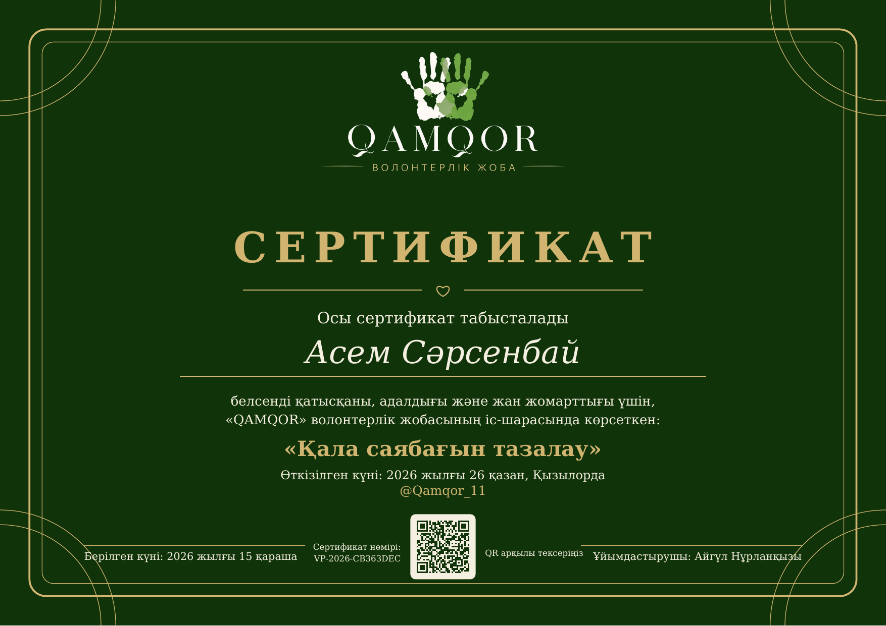
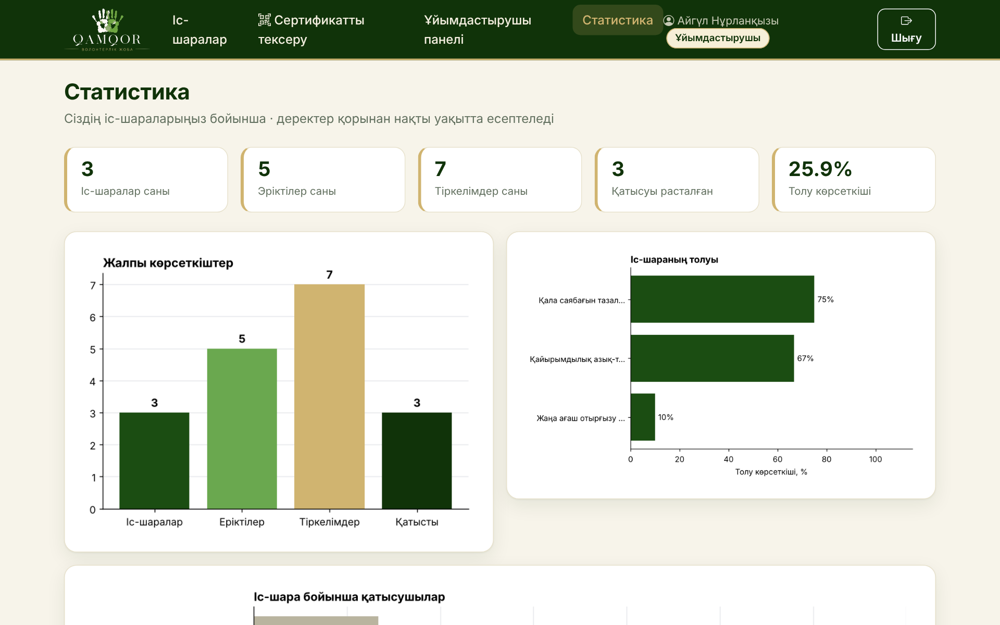

<p align="center"></p>

# Еріктілер іс-шаралары порталы

Python және Flask негізіндегі үш тілдік волонтёрлік платформа: іс-шараларды жариялау, тіркелу, қатысуды QR арқылы белгілеу, күту тізімі және тексерілетін PDF-сертификаттар.


<p align="center"></p>

## Әзірлеушілер

- **Али** — бастапқы қосымша, деректер қоры, сервис қабаты және тесттер.
- **Дана (@RuslanDana)** — жобаны бірлесіп әзірлеу, интерфейс және сертификат дизайны.

## Мүмкіндіктер

- Үш рөл: ерікті, ұйымдастырушы және әкімші; құқықтар сервер жағында тексеріледі.
- Іс-шара каталогы: іздеу, қала/күн/санат сүзгілері және бос орын саны.
- Қатысушылар саны шектеледі; орын қалмаса, FIFO күту тізімі ұсынылады.
- Еріктілер таңдаулы іс-шараларды сақтайды, қатысқан іс-шарадан соң пікір қалдырып, баға бере алады.
- Ұйымдастырушылар іс-шаралар мен қатысушыларды басқарады; жаңа ұйымдастырушыларды әкімші мақұлдайды.
- Динамикалық QR check-in, PDF-сертификат және `/verify` бетінде сертификатты тексеру.
- Үш тіл: қазақша, орысша және ағылшынша; email-хабарландырулар SMTP арқылы қосымша бапталады.
- Ерікті ID, сағат, жетістіктер және рейтинг; әкімші әрекеттерінің аудит журналы.
- Статистика, CSV экспорт және интерфейстің телефонға бейімделуі.

| Сертификат | Тексеру | Статистика |
|---|---|---|
|  |  |  |

## Жылдам бастау

Python 3.11+ қажет.

```bash
python -m venv .venv
# Windows PowerShell: .venv\Scripts\Activate.ps1
# Linux/macOS: source .venv/bin/activate
python -m pip install -r requirements.txt
flask --app run init-db
flask --app run seed-demo
python run.py
```

Қосымша `http://127.0.0.1:5000` мекенжайында ашылады. Демо аккаунттар мен орнатудың толық қадамдары: [docs/installation_guide.md](docs/installation_guide.md). Демо парольдерді ашық не өндірістік ортада қолданбаңыз.

## Баптау

`SECRET_KEY`, `DATABASE`, `CERTIFICATE_DIR`, `PUBLIC_URL`, `FLASK_DEBUG`, `HOST` және `PORT` ортаның айнымалыларымен бапталады. SMTP хабарландырулары үшін `MAIL_ENABLED`, `MAIL_SERVER`, `MAIL_PORT`, `MAIL_USE_TLS`, `MAIL_USERNAME`, `MAIL_PASSWORD`, `MAIL_DEFAULT_SENDER` қолданылады. Нақты мәндер мен қауіпсіздік бойынша нұсқаулар — орнату нұсқаулығында.

## Тесттер

```bash
python -m pytest
python -m pytest --cov=app/services --cov-report=term-missing
```

Жоба тарихындағы соңғы көрсеткіш: 338 тест өтті, 1 тест өткізіліп жіберілді (`CHANGELOG.md`). Егжей-тегжейлі тест есебіндегі 204 тест — 2026-11-12 күнгі бұрынғы өлшем; қараңыз [docs/test_report.md](docs/test_report.md).

## Құжаттама

- [Архитектура](docs/architecture.md)
- [Деректер қоры](docs/database_design.md)
- [Орнату](docs/installation_guide.md)
- [Пайдаланушы нұсқаулығы](docs/user_manual.md)
- [Тест есебі](docs/test_report.md)
- [Құжаттамадағы ескертпелер](docs/documentation_review.md)
- Өзгерістер тарихы: [CHANGELOG.md](CHANGELOG.md)
