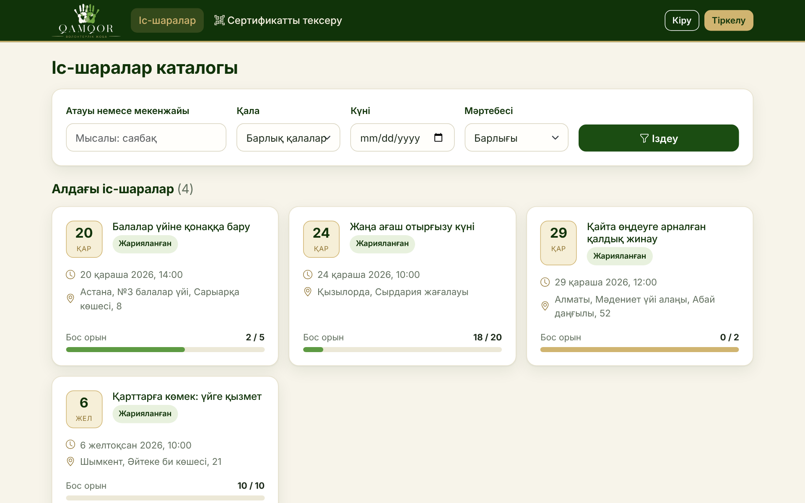
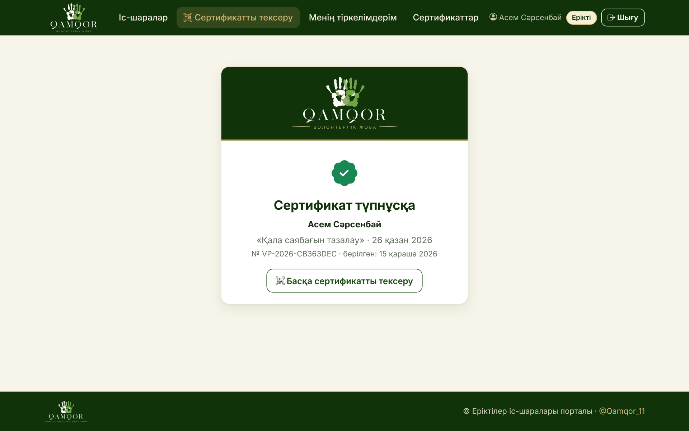

<p align="center"></p>

# Еріктілер іс-шаралары порталы


**Volunteer Events Portal** (Flask): іс-шара жариялау, тіркелу, қатысуды растау, QR-кодты PDF-сертификат және оны сайтта тексеру. Интерфейс: қазақша.

<p align="center"></p>

## Авторлар
- **Али**: сайттың негізі, деректер қорымен жұмыс, сервис қабаты, тесттер.
- **Дана**: дизайн, сайттың сыртқы түрі, сертификат дизайны.

## Мүмкіндіктер
- Каталог: іздеу, 22 қала, күн және мәртебе сүзгісі, бос орын көрсеткіші.
- Үш рөл: ерікті, ұйымдастырушы, әкімші (сервер жағында тексеріледі), әрқайсысына **жеке кабинет**: сан-көрсеткіштер, жақын іс-шаралар, профиль, құпиясөзді өзгерту.
- **Қауіпсіздік:** кіруді шектеу (brute-force), CSP және қауіпсіздік заголовоктары, сессияны жаңарту, кэш қорғанысы. Толығырақ: `docs/audit_report.md`.
- Орын шегі бір мезгілдегі тіркелуден қорғалған (транзакция + UNIQUE).
- QAMQOR дизайнындағы PDF-сертификат және QR; `/verify` бетінде камера/сурет/нөмір арқылы тексеру.
- **QR арқылы өзін-өзі белгілеу:** ұйымдастырушы экранында әр 30 секунд сайын жаңаратын QR; ерікті телефонымен сканерлеп, қатысуын өзі растайды (суретке түсіріп жіберу көмектеспейді).
- Статистика графиктері; қатысушыларды CSV-ға жүктеу.
- 163 автоматты тест, қамту 97 %, CSRF, параметрленген SQL.

| Сертификат (QR) | Тексеру | Статистика |
|---|---|---|
|  |  |  |

## Жылдам бастау
```bash
pip install -r requirements.txt
flask --app run init-db && flask --app run seed-demo
python run.py        # http://127.0.0.1:5000
```
Демо-аккаунттар төменде. Толық нұсқаулық: `docs/installation_guide.md`.

---

Flask-та жасалған веб-қосымша: еріктілер іс-шараларды іздейді, тіркеледі, қатысуы расталған соң PDF-сертификат алады; ұйымдастырушылар іс-шараларды және қатысушыларды басқарады; әкімші платформаны бақылайды. Интерфейс тілі: қазақша.

## Технологиялар
Python, Flask, Flask-Login, SQLite, Werkzeug, Jinja2, Bootstrap 5 (локалды), ReportLab (PDF), Matplotlib (графиктер), pytest, pytest-cov.

## Жүйелік талаптар
Python 3.11+ (тексерілген: 3.13). Орнату үшін интернет.

## Орнату
```bash
python -m venv .venv
# Windows:   .venv\Scripts\activate
# Linux/mac: source .venv/bin/activate
pip install -r requirements.txt
```

## Конфигурация
Әдепкі мәндермен жұмыс істейді. Қажет болса ортаның айнымалылары: `SECRET_KEY`, `DATABASE`, `CERTIFICATE_DIR`, `FLASK_DEBUG` (әдепкіде өшірулі), `PUBLIC_URL` (сертификаттағы QR-кодтың сайт мекенжайы, мысалы `https://portal.example.kz`; берілмесе сұраудың мекенжайы алынады). `SECRET_KEY` берілмесе, `instance/secret_key` жасалады (Git-ке түспейді).

## Деректер қорын құру
Автоматты түрде бірінші іске қосуда (`instance/volunteer.db`). Қолмен: `flask --app run init-db`.
Демо-деректер: `flask --app run seed-demo`. Әкімші: `flask --app run create-admin`.

## Іске қосу
```bash
python run.py
```
http://127.0.0.1:5000

## Тесттер және қамту
```bash
python -m pytest
python -m pytest --cov=app/services --cov-report=term-missing
```
Соңғы нәтиже: 163 тест өтті, бизнес-логика қамтуы 97 % (`docs/test_report.md`).

## Тест аккаунттар (тек `seed-demo` жүктелгенде)
| Рөл | Email | Пароль |
|---|---|---|
| Әкімші | admin@volunteer.kz | Admin12345 |
| Ұйымдастырушы | aigul@volunteer.kz | Demo12345 |
| Ерікті | volunteer1@volunteer.kz | Demo12345 |

Өндірісте бұл аккаунттарды пайдаланбаңыз.

## QR-код және сертификатты тексеру
- PDF-сертификатта QR-код бар: ол `<сайт>/verify/<нөмір>` сілтемесін береді.
- `/verify` бетінде («Сертификатты тексеру» мәзірі, кіруді талап етпейді) сканер: камера, QR-сурет (скриншот/фото) жүктеу немесе нөмірді қолмен енгізу. Нөмір мен түпнұсқалықты сервер тексереді.
- Браузер камерасы тек `https://` немесе `localhost` арқылы жұмыс істейді; басқа жағдайда сурет жүктеу мен қолмен енгізу қолжетімді.
- QR ішінде `localhost` мекенжайы болса, оны басқа құрылғы ашпайды: нақты мекенжайды `PUBLIC_URL` арқылы беріңіз. Сайттың өз сканері мекенжайға қарамай нөмірді алады.
- Ескі PDF-тер QR-сыз қалады: `generated/certificates/*.pdf` өшіріп, қайта жүктеңіз.

## Көрсетілімге дайындық
`docs/demo_checklist.md`: сценарий, аккаунттар, күтілетін сұрақтар.

## Телефоннан кіру
Bір Wi-Fi желісінде: `HOST=0.0.0.0 python run.py`, телефонда `http://<компьютер IP>:5000`. Толығырақ: `docs/phone_access.md`.

## Жариялау және жол картасы
- Интернетке шығару (https): `docs/deployment.md`. Өндірістік іске қосу: `gunicorn wsgi:app` (`requirements-deploy.txt`).
- Ұйымдастырушы қатысушылар бетінен тізімді CSV-ға жүктей алады.
- Өзгерістер: `CHANGELOG.md`; финалға дейінгі жоспар: `docs/roadmap.md`.

## Брендинг және қалалар
- Логотип: `app/static/images/logo.png` (шапка, hero, кіру беттері, футер, сертификат). Ауыстыру үшін осы файлды өз суретіңізбен алмастырыңыз (мөлдір фонды PNG), серверді қайта іске қосыңыз.
- Түстер: `app/static/css/style.css` ішіндегі `:root`; сертификат түстері мен мәтіні: `app/services/certificate_service.py` (бастапқы тұрақтылар).
- Қалалар тізімі: `app/models.py` ішіндегі `CITIES`. Іс-шара қаласы мен мекенжайы бөлек өрістер. Ескі қор (қала бағанасыз) бірінші іске қосуда автоматты көшіріледі.

## Құжаттама
`docs/` бумасы: техникалық тапсырма, аналогтар талдауы, архитектура, деректер қоры, интерфейс, тест есебі, пайдаланушы және орнату нұсқаулықтары, түсіндірме жазба.
