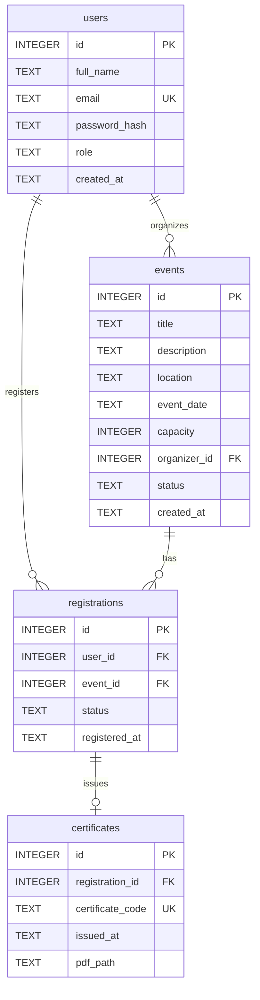

# Деректер қорын жобалау

СУБД: SQLite. Схема `app/database.py` ішіндегі `SCHEMA` айнымалысында. `PRAGMA foreign_keys = ON` әр қосылымда қосылады.

(Mermaid көзі: `er_diagram.mmd`.)

## Кестелер
### users
| Өріс | Түрі | Шектеу |
|---|---|---|
| id | INTEGER | PK, AUTOINCREMENT |
| full_name | TEXT | NOT NULL |
| email | TEXT | NOT NULL, UNIQUE (кіші әріпке келтіріледі) |
| password_hash | TEXT | NOT NULL (Werkzeug хеші) |
| role | TEXT | CHECK ∈ {volunteer, organizer, admin} |
| created_at | TEXT | әдепкі: жергілікті уақыт |

### events
| Өріс | Түрі | Шектеу |
|---|---|---|
| id | INTEGER | PK |
| title, location | TEXT | NOT NULL |
| description | TEXT | әдепкі '' |
| event_date | TEXT | `YYYY-MM-DD HH:MM` (мәтін ретінде салыстыруға болады) |
| capacity | INTEGER | CHECK capacity > 0 |
| organizer_id | INTEGER | FK → users.id, ON DELETE CASCADE |
| status | TEXT | CHECK ∈ {published, cancelled} |
| created_at | TEXT | |

### registrations
| Өріс | Түрі | Шектеу |
|---|---|---|
| id | INTEGER | PK |
| user_id | INTEGER | FK → users.id, CASCADE |
| event_id | INTEGER | FK → events.id, CASCADE |
| status | TEXT | CHECK ∈ {pending (Расталмаған), attended (Қатысты), absent (Қатыспады)} |
| registered_at | TEXT | |
| | | **UNIQUE(user_id, event_id)** |

### certificates
| Өріс | Түрі | Шектеу |
|---|---|---|
| id | INTEGER | PK |
| registration_id | INTEGER | FK → registrations.id, CASCADE, UNIQUE |
| certificate_code | TEXT | UNIQUE |
| issued_at | TEXT | |
| pdf_path | TEXT | NOT NULL |

## Байланыстар
- users 1—N events (ұйымдастырушы).
- users 1—N registrations; events 1—N registrations (users мен events арасындағы N—M байланысы).
- registrations 1—0..1 certificates.

## Индекстер
`events(event_date)`, `events(organizer_id)`, `registrations(event_id)`.

## Тұтастық пен транзакциялар
- Қайталанатын тіркелуден UNIQUE шектеуі қорғайды (сервис алдын ала тексереді, DB соңғы қорғаныс).
- Тіркелу `BEGIN IMMEDIATE` транзакциясында: жазу құлпы алынғаннан кейін орын саны есептеліп, INSERT жасалады. 5 ағынды тест (`test_concurrent_registration_never_exceeds_capacity`) нақты 2 орынға 2 сәтті тіркеуді көрсетті.
- Іс-шара/пайдаланушы жойылғанда байланысты тіркелімдер мен сертификат жазбалары CASCADE арқылы жойылады, PDF файлдары сервис қайтарған жолдар бойынша өшіріледі.
- SQLite-тың `LOWER()` кириллицаны төмендетпейді; сондықтан `PYLOWER` функциясы тіркелген (іздеу тесті мұны ашты).
