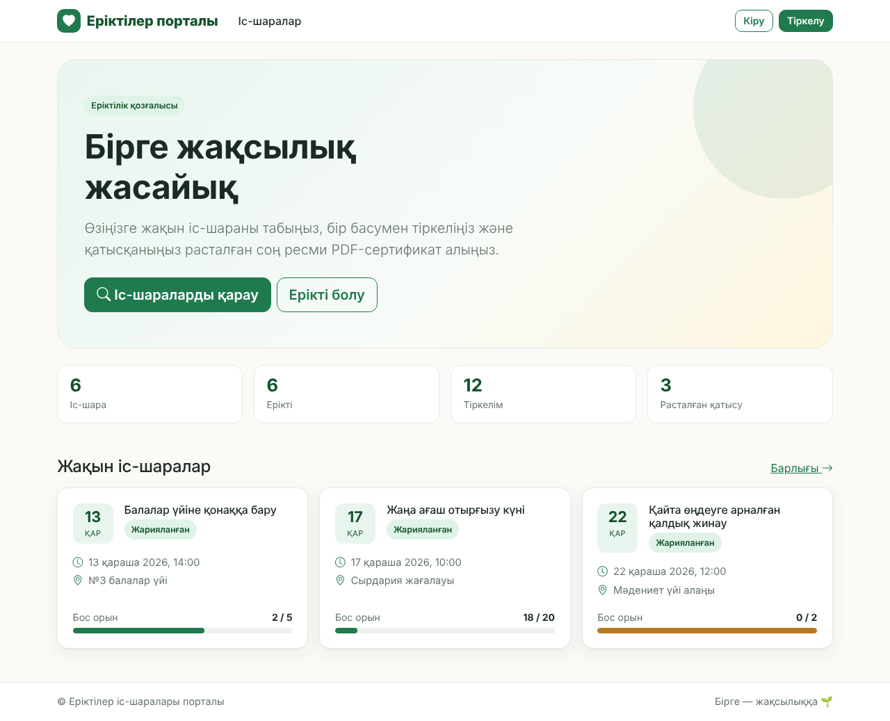
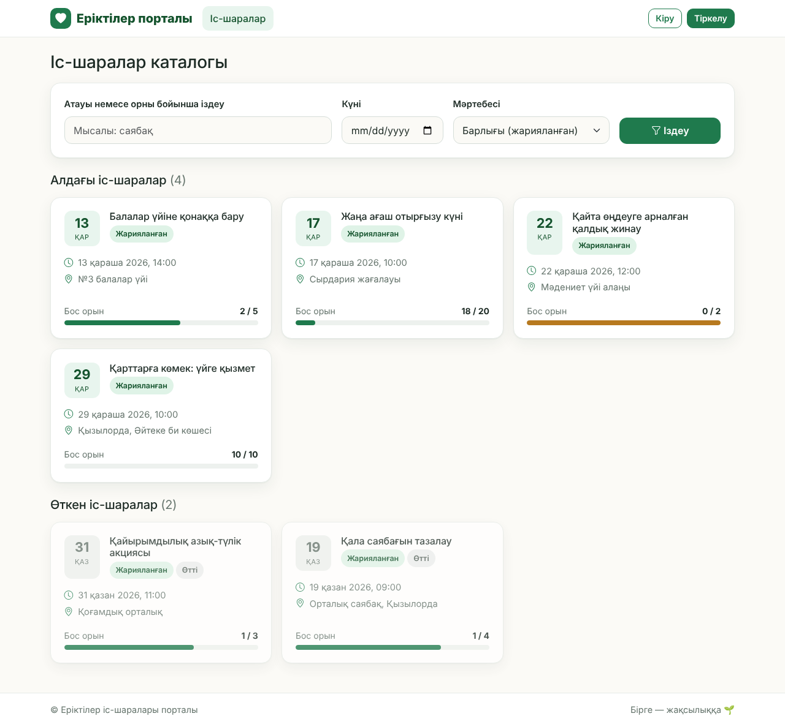
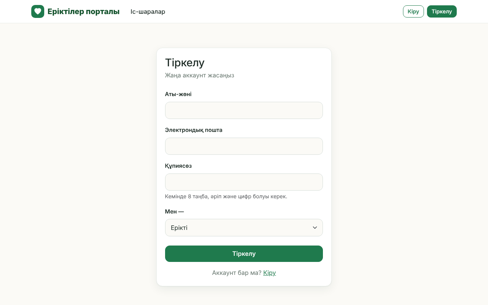
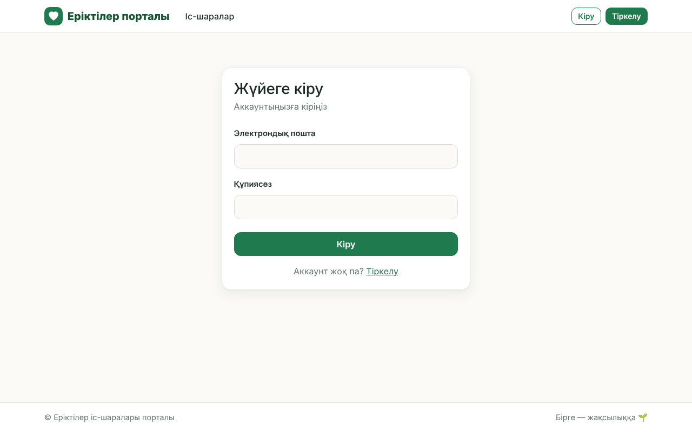
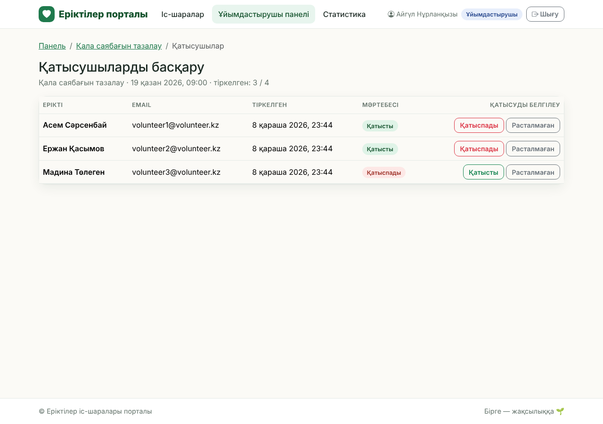
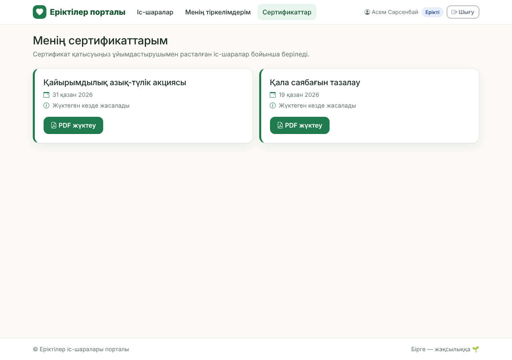
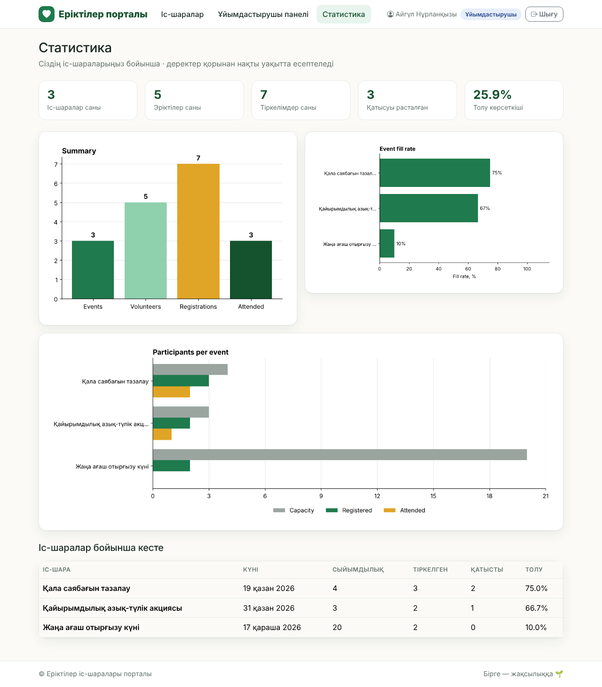
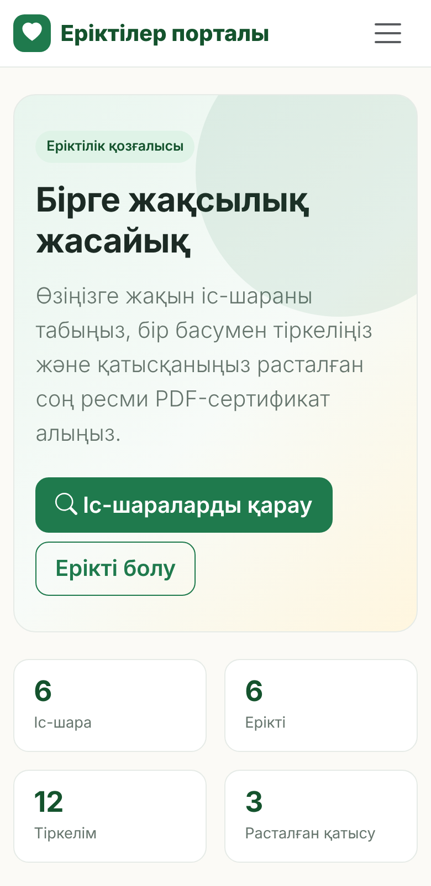
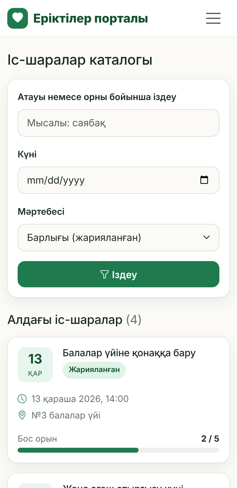

# Интерфейс макеті

Төмендегі суреттер дайын қосымшаның нақты скриншоттары (Chromium, демо-деректермен). Дизайн жүйесі: ашық фон, негізгі жасыл түс (#1f7a4d), дөңгеленген карточкалар (16 px), жұмсақ көлеңкелер, жүйелік қаріп стегі; Bootstrap 5 негізінде, `app/static/css/style.css` ішінде бірыңғай токендермен.

| № | Бет | URL | Скриншот |
|---|---|---|---|
| 1 | Басты бет | `/` |  |
| 2 | Іс-шаралар каталогы (іздеу, сүзгі) | `/events` |  |
| 3 | Іс-шара беті (қонақ) | `/events/<id>` |  |
| 3б | Іс-шара беті (ерікті, тіркелу) | `/events/<id>` |  |
| 4 | Тіркелу | `/register` |  |
| 5 | Кіру | `/login` |  |
| 6 | Эріктінің жеке кабинеті | `/my` |  |
| 7 | Ұйымдастырушы панелі | `/organizer` |  |
| 7б | Іс-шара құру/өңдеу формасы | `/organizer/events/new` |  |
| 8 | Қатысушыларды басқару | `/organizer/events/<id>/participants` |  |
| 9 | Сертификаттар беті | `/certificates` |  |
| 9б | PDF-сертификат үлгісі | жүктеу |  |
| 10 | Статистика | `/statistics` |  |
| 11 | Әкімші панелі | `/admin/` |  |
| — | Мобильді көрініс (390 px) | `/`, `/events` |   |

Күйлер: бос деректер (мысалы, «Әзірге ешкім тіркелмеген»), қате/ескерту хабарламалары (flash), батырмадағы жүктелу индикаторы (`data-loading`), графиктердің жүктелу/қате күйі, 403/404/500 беттері.
